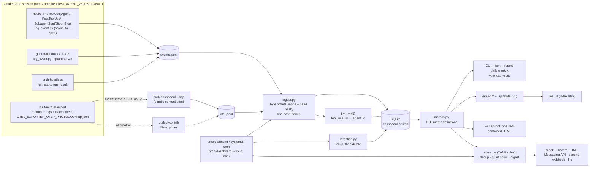

# Agent workflow dashboard v2: design

Status: implemented (P1–P4), verified on recorded fixtures on 2026-11-25. Not yet run against a live
Claude Code session on this machine; see "Open items".

Companion files: [adr.md](adr.md) (D1–D5) · [research.md](research.md) (R1–R5, sources) ·
[verification-log.md](verification-log.md) · code in `claude-home/agent-dashboard/agentdash/`.

## 1. Overview

v2 is a headless-first monitor for the orchestrator / worker / advisor workflow. It is one Python package
(`agentdash`, standard library only) plus the existing hook. Two append-only files are the only things
written while an agent runs. The v2 hook writes `events.jsonl`, which carries task semantics, worker STATUS,
advisor FROM MEMORY and guardrail hits. A loopback OTLP/HTTP receiver writes `otel.jsonl`, which carries
Claude Code's own cost, token and span telemetry. Neither writer touches the database, so neither can slow
or break a session. An ingester reads both files from stored byte offsets into SQLite. It is idempotent,
and it survives log rotation and truncation. A join step links OTel spans to hook dispatches through
`tool_use_id`. One metrics module turns the store into numbers, and every output uses it: the CLI
(`--json`, `--report`), the versioned JSON API, the live UI, the static snapshot and the alert rules. The
alert rules run from a 5-minute timer (launchd, systemd or cron). They post to Slack, Discord, LINE
(Messaging API) or any HTTP endpoint, with dedup and quiet hours. No browser is needed for any of it.

## 2. Architecture



## 3. Data model

DDL: `agentdash/store.py` (migrations 1–3). Summary:

| Table | Grain | Key columns | Retention |
|---|---|---|---|
| `schema_migrations` | migration | version | forever |
| `ingest_state` | source file | source, dev, inode, offset, head_hash | forever |
| `raw_events` | hook line | `line_hash` UNIQUE, ts, event, project, session_id, agent_id, tool_use_id, payload (whitelisted fields, no content) | `raw_days` = 30 |
| `dispatches` | Agent tool call | tool_use_id PK, session_id, project, task_id, agent, status, attempts, confidence, from_memory, has_verification, tokens_hook, agent_id, join_method, result_text (NULL by default) | `structured_days` = 180 |
| `tool_events` | non-Agent tool call | ts, session_id, agent, agent_id, tool, failed | 30 |
| `guardrail_hits` | hit | guardrail, task_id, dispatch_id, source (event / marker), reason (redacted) | 180 |
| `plan_items` | todo / task item | (project, session_id, item_key) | 180 |
| `runs` | headless run start / result | run_id, cost_usd, duration_ms, is_error, prompt_len (prompt NULL by default) | 180 |
| `otel_spans` | span | (trace_id, span_id), parent_span_id, name, session_id, tool_use_id, agent_id, tokens | 30 |
| `otel_logs` | OTel event | rec_hash UNIQUE, name, session_id, prompt_id, agent_id, tool_use_id, cost_usd, tokens | 30 |
| `otel_metric_points` | data point | rec_hash UNIQUE, name, session_id, type, value (cumulative sums are stored as deltas) | 30 |
| `otel_cumulative` | cumulative series | series hash, last_ts, last_value | forever (one row per series) |
| `rollup_dirty` | UTC day | day: got new data since its aggregates were written | until the next rollup |
| `daily_aggregates` | day × project × metric | num, den, value | **forever** |
| `alert_state` | dedup key | status, first_seen, last_seen, last_sent, send_count, held | resolved, or not seen and nothing owed: 180 |
| `alert_log` | delivery attempt | channel, ok, error | 30 |

Indexes are on every time column and on the join keys: `ix_raw_session`, `ix_disp_task`, `ix_disp_agent_id`,
`ix_span_tool_use`, `ix_span_parent`, `ix_olog_agent`, and others.

**Task identity.** A task is `(project, session_id, task_id)`. v1 used `(project, task_id)`, which merged
`T1` from every session into one task. Assumption: a task never moves to another session. If
`claude --resume` keeps the session ID, resumed work stays the same task.

**Migrations** are append-only, are recorded in `schema_migrations`, and run at every `store.connect()`.
Running them twice is a no-op; `test_migrations_idempotent` checks this.

### 3.1 Incremental ingestion

For each source, `ingest_state` stores `(dev, inode, offset, head_hash)`. The head hash is the SHA-1 of the
first ≤256 bytes, stored with its length.

| Situation | Detection | Action |
|---|---|---|
| normal append | same inode, size ≥ offset, head matches | read from offset |
| writer mid-line | no trailing `\n` | stop before the partial line; it is read on the next run |
| rotation (rename + new file) | inode changed | find the old inode among `events.jsonl*`, drain it from the old offset, then read the new file from 0 |
| truncate / copytruncate / replace | size < offset or head hash differs | read from 0; already-seen lines are skipped by `line_hash` UNIQUE |
| malformed line | JSON error or no `ts` | counted as `bad`, skipped |

Measured: a first ingest of 100,000 lines takes 2.9 s. The next ingest, with one new line, takes 3 ms and
reads 1 line ([verification-log.md](verification-log.md)). v1 re-read the whole log on every request.

### 3.2 Join between hook events and OTel

| Key | Hook side | OTel side | Reliability |
|---|---|---|---|
| `session_id` | every hook input (`session_id`) | `session.id` on all metrics, events and spans (on by default) | **exact**: the same Claude Code session ID |
| `tool_use_id` (dispatch → span) | PreToolUse / PostToolUse input `tool_use_id` | `claude_code.tool` span attribute `tool_use_id` / `gen_ai.tool.call.id`; `tool_result` event `tool_use_id` | **exact**, when traces are on (beta) |
| dispatch → subagent `agent_id` | SubagentStart (`agent_id`, `agent_type`) | child spans of the Agent tool span carry `agent_id`; `api_request` events carry `agent_id` (v2.1.310+) | **trace**: exact (the subagent's spans nest under the parent `claude_code.tool` span). **single_running**: unambiguous only when one dispatch of that type is running in the session; skipped otherwise |
| cost / tokens → task | — | `api_request.cost_usd` / tokens by `agent_id` | exact once `agent_id` is joined; the orchestrator's own calls are `agent_id IS NULL` |

`join_otel()` records the method used in `dispatches.join_method` (`trace` / `single_running` / `none`).
`/api/v1/metrics` returns the counts per method under `join`, so the reliability of the join is
measured on every run, not assumed. On the fixture, all 29 dispatches in traced sessions joined by
`trace`; the other 24 joined by `single_running`.

Fallbacks when OTel is missing or old:
* No traces (beta off): `single_running` via SubagentStart or `api_request.agent_id`.
* Claude Code older than v2.1.310 (no `agent_id` on events): per-dispatch tokens fall back to the hook's
  `totalTokens`, and session cost still comes from `api_request` events.
* No OTel at all: cost comes from `run_result.cost_usd` (headless runs only). Tokens come from the hook.
  The dashboard shows which source it used (`cost_sources`, `agents._token_sources`).

### 3.3 Retention

The timer runs `retention.maybe_daily()` once every 24 h. It first rolls up every day that still has raw
data into `daily_aggregates`, then deletes:
* raw (`raw_days`, default 30): `raw_events`, `tool_events`, `otel_*`, `alert_log`
* structured (`structured_days`, default 180): `dispatches`, `guardrail_hits`, `runs`, `plan_items`,
  resolved `alert_state`
* never: `daily_aggregates`, stored as num/den so weekly and monthly trends re-aggregate exactly.
  `test_rollup_then_delete` shows trends are unchanged after all raw rows are gone.

The source files `events.jsonl` and `otel.jsonl` are not truncated by v2. Rotating them, for example
with `newsyslog` or `logrotate` (rename, or copytruncate), is safe. The 30/180-day values are the
brief's example values, not sourced figures. Change them in `config.yaml`.

## 4. Metrics

One registry, `agentdash/metrics.py::METRICS`. `orch-dashboard --spec` prints it. The API, CLI, UI,
snapshot and alerts all call `metrics.compute()`.

**Window rules.** Task-outcome metrics count tasks whose terminal time (DONE or STUCK) falls in
`[since, until)`. Each task's full history is loaded, so its state is never judged from a partial
history. Dispatch metrics count dispatches that ended in the window. Hits, cost and tool calls count by
timestamp. With these rules, summing daily `tasks_done` gives the all-time total
(`test_window_counts_each_task_once`).

**Task states.** `done`: the last worker report is WORKS. `stuck`: a worker report is not WORKS after 2
advisor rounds, or the headless run ended (`run_result`) with the task unresolved. Everything else is
active (`in_progress`, `failing`, `consulting`, `retry_pending`).

| name | formula | source | unit | min n | alert threshold |
|---|---|---|---|---:|---|
| `tasks_done` | count(tasks, state=done, end in window) | hook dispatches | tasks | — | — |
| `tasks_stuck` | count(tasks, state=stuck, end in window) | hook dispatches + run_result | tasks | — | any new one → `task_stuck` (default rule) |
| `first_try_success_pct` | terminal tasks whose first worker report is WORKS ÷ terminal tasks | hook | % | 5 | suggested < 40 %/week (not a default rule) |
| `escalation_pct` | terminal tasks with ≥1 advisor round ÷ terminal tasks | hook | % | 5 | suggested > 60 %/week |
| `advisor_fix_pct` | escalated terminal tasks ending done ÷ escalated terminal tasks | hook | % | 5 | < 50 % over the last 20 escalations (default rule, needs n = 20) |
| `worker_success_pct` | WORKS reports ÷ finished worker dispatches (incl. NO_REPORT, ERROR) | hook | % | 10 | — |
| `avg_task_sec` | mean(end − first dispatch start) over done tasks | hook | s | 3 | — |
| `throughput_per_day` | tasks done ÷ window days | hook | tasks/day | — | — |
| `cost_usd` | Σ cost in window, one source per session: OTel `api_request` > OTel `cost.usage` > `run_result` | OTel / run_result | USD | — | > `budget_usd` per UTC day (default rule) |
| `cost_per_solved_task_usd` | `cost_usd` ÷ `tasks_done` | OTel + hook | USD | 1 | — |
| `guardrail_hits_per_task` | hits in window ÷ tasks touched in window; also per G-number | guardrail_hits | hits/task | 5 | any G3/G8 hit (default rule) |
| `fake_works_pct` | WORKS reports with ≥1 G3/G4/G8 hit attributed to that dispatch ÷ WORKS reports | guardrail_hits + hook | % | 5 | example rule > 10 %/7d |
| `memory_hit_pct` | advisor guidances with FROM MEMORY ≠ none ÷ guidances that contain the field | hook (parsed at capture) | % | 5 | — |
| `memory_assisted_success_pct` | terminal tasks with a memory-hit guidance ending done ÷ terminal tasks with a memory-hit guidance | hook | % | 3 | — |
| `tool_failure_pct` | PostToolUseFailure ÷ all non-Agent tool results | hook | % | 20 | — |
| `advisor_rounds_distribution` | histogram {0, 1, 2, 3+} of advisor rounds over terminal tasks | hook | tasks | — | — |
| per agent | dispatches, running, busy_sec, utilization (busy ÷ observed session wall time), avg / p90 duration, tool calls / failures, tokens (OTel by `agent_id` > span tokens > hook `totalTokens`) | hook + OTel | mixed | — | — |
| weekly trend of each | Σ num ÷ Σ den per ISO week from `daily_aggregates` | daily_aggregates | as above | as above | — |

Values below `min n` are still returned, flagged `sufficient: false`, and shown with ⚠︎ in the UI and
reports. The min-n values and the "suggested" thresholds are starting points I chose; no source gives
them. Tune them once real data exists.

**Definition changes from v1** (all deliberate, all documented in the code):
1. A task key includes the session (see §3).
2. First-try success, escalation and fix rate count terminal tasks only. v1 also counted in-flight
   tasks, so a task changed category while it ran.
3. Fake-WORKS counts distinct WORKS dispatches with a hit, not raw hits. This keeps it a rate ≤ 100 %.
   The brief's literal "hits ÷ WORKS" can exceed 100 % when one report trips G3 and G4.
4. Throughput is per day (the v1 per-hour value is still returned on `/api/state`).

Fixture check: every ratio in the table above is checked against counts made independently by the
fixture generator (`test_ratio_metrics_match_independent_count`).

## 5. Guardrail hits: capture contract

No guardrail hook code exists yet (`hooks/guardrails.yaml` is a spec). v2 accepts hits three ways, in
order of reliability:
1. **Explicit event** (preferred). The guardrail hook calls
   `python3 ~/.claude/hooks/log_event.py --guardrail G3 --reason "..."`, piping its own hook stdin. The
   hit carries `session_id`, `tool_use_id` and `agent_id`, so attribution is exact.
2. **Marker in a failure.** A PreToolUse guardrail that blocks with exit 2 puts `GUARDRAIL G8: <reason>`
   on stderr. When that text reaches a `PostToolUseFailure` `error`, the hook records it.
3. **Marker in a report.** `GUARDRAIL Gn`, `[Gn]` or `Gn hit` in a worker or advisor report, or in a
   SubagentStop / Stop message.

Attribution order: explicit `task_id` → `tool_use_id` → `agent_id` → the dispatch running in that
session at that time → a dispatch that ended ≤ 5 min earlier (G3/G4 typically fire just after a report).
Unattributed hits are counted and shown.

## 6. Alerts

Rules: `alerts.example.yaml`, installed once as `~/.claude/agent-dashboard/alerts.yaml`. Default rules:

| id | kind | fires when | key (dedup) | repeats |
|---|---|---|---|---|
| `task_stuck` | task_stuck | a task became STUCK within `lookback` | project:session:task | never |
| `guardrail_g3_g8` | guardrail_hit | a G3 or G8 hit within `lookback` | hit id | never |
| `daily_budget` | cost_over_budget | cost of the current UTC day > `budget_usd` | project:day | never |
| `advisor_fix_rate_low` | advisor_fix_rate | fix rate over the last 20 finished escalations < 50 % (needs 20) | project | 24 h, sends "resolved" |
| `headless_silent` | no_events | a `run_start` with no `run_result`, and no event for N min | run_id | 1 h, sends "resolved" |
| (any) | metric_threshold | any registry metric, window, op, value; ignored below min n | project | `repeat_interval` |

**Alert-fatigue controls** (following Alertmanager and the SRE book, see R5):
* Dedup by key. Event rules fire once per key. Stateful rules re-notify only after `repeat_interval`
  and send a "resolved" message.
* Grouping: more than `max_per_channel_per_run` (default 5) alerts for one channel in one tick become
  one digest message.
* Quiet hours (`start`, `end`, `tz`, optional `days`; windows may cross midnight). Alerts are held,
  not dropped, and go out at the first tick after quiet hours end. Severities in `allow_severity`
  (default `critical`) bypass this.
* Failed deliveries are marked held and retried on the next tick. Channels whose env var is missing are
  skipped without error, so a laptop with no secrets still runs cleanly.
* Every rule reads `metrics`, and threshold rules respect `min n`.

**Payload** (generic webhook and file channel; Slack, Discord and LINE get a text rendering of it):

```json
{
  "schema": "agentdash.alert/v1",
  "id": "1b8eb7bb8b8a",
  "dedup_key": "task_stuck:shop-api:s-shop-3:T3",
  "rule": "task_stuck", "kind": "task_stuck", "severity": "high", "status": "firing",
  "project": "shop-api", "task_id": "T3", "session_id": "s-shop-3",
  "summary": "Task T3 is STUCK in shop-api after 0 advisor round(s)",
  "details": {"reason": "run_ended_unresolved", "worker_runs": 1, "advisor_rounds": 0, "title": "[T3] Implement task T3", "guardrails": []},
  "first_seen": 1795392000.0, "last_seen": 1795392000.0, "occurrences": 1,
  "inspect": {"command": "orch-dashboard --json --project shop-api --task T3", "url": "http://127.0.0.1:8765/?project=shop-api"}
}
```

Transports: Slack incoming webhook `{"text", "blocks"}`. Discord execute-webhook `{"content" ≤ 2000,
"embeds" ≤ 10}`. LINE Messaging API push (`POST https://api.line.me/v2/bot/message/push`,
`Authorization: Bearer <channel access token>`, `{"to", "messages":[{"type":"text"}]}`); LINE Notify was
discontinued on 2025-03-31. Generic HTTP POST of the payload. A local file. Secrets live only in env vars,
read from `alerts.env` (mode 600) by `orch-dashboard-tick`.

## 7. Privacy and safety

| Requirement | How |
|---|---|
| No content by default | The hook parses reports at capture time and writes only structured fields. `result_text` and the headless `prompt` are written only with `AGENT_DASHBOARD_LOG_CONTENT=1` / `privacy.store_result_text`. v1 lines that already contain `result_text` are parsed on ingest and the text is dropped. The OTLP receiver removes content attributes (`prompt`, `tool_input`, `response`, `user.email`, …) before writing, and the ingester stores only whitelisted columns. Claude Code's own content flags (`OTEL_LOG_USER_PROMPTS`, `OTEL_LOG_TOOL_DETAILS`, `OTEL_LOG_TOOL_CONTENT`) are left off. |
| Redaction when content is enabled | built-in patterns (Anthropic/OpenAI incl. `sk-proj-`, GitHub, AWS, Google, Slack keys, `Bearer`/`Basic` credentials, private keys, JWTs, `password=…` / `"api_key": "…"` / `MY_SECRET_KEY=…`, e-mail addresses) plus user regexes in `privacy.redact`. The hook applies them at capture to the text it always keeps (task descriptions, todo text, guardrail reasons); without the agentdash package it drops `result_text` instead of writing it |
| Loopback only | Both servers refuse any host other than 127.0.0.1, localhost or ::1 (`test_refuses_non_loopback`) |
| Fails open | The hook is `async: true`, wraps everything in try/except and always exits 0 (tested with garbage stdin and an unwritable directory). OTel export failures are silent in Claude Code. The receiver writes only a file. The ingester runs out of process. |
| Opt-in logging | The hook is a no-op unless `AGENT_WORKFLOW=1`. OTel export is set only by `orch` / `orch-headless`, via `otel-env.sh`. |
| Network | Nothing leaves the machine except the webhooks you configure |

## 8. Implementation plan

| Phase | Scope | Done when (check) | Status |
|---|---|---|---|
| P1 | SQLite store + migrations, incremental ingest, metrics module, CLI (`--json`, `--report`, `--since`, `--project`, `--task`), v1-compatible `/api/state` + `server.py` shim | `python3 -m unittest discover -s tests` passes the metrics, ingestion, v1-compat and privacy tests; `orch-dashboard --ingest` run twice reads 0 lines the 2nd time | ✅ 2026-11-25 |
| P2 | alerts.yaml, 5 default rules + metric_threshold, dedup, quiet hours, digest, Slack/Discord/LINE/webhook/file, `--tick`, launchd/systemd/cron | `TestAlerts` passes; a real `--tick` writes 8 alerts as one digest; the 2nd tick sends 0 | ✅ |
| P3 | OTLP/HTTP JSON receiver, OTel ingest (traces, logs, metrics; wrapped or collector format), `join_otel`, cost/token source priority | `TestOtlpReceiver` passes; curl JSON → 200, protobuf → 415, prompt absent from file; fixture: all traced dispatches joined by `trace` | ✅ (fixture). Live Claude Code export still to be checked, see Open items |
| P4 | `/api/v1/*`, UI: quality/guardrails/memory, weekly trends, alerts; static snapshot | `TestOutputs` passes; screenshots in `docs/screenshots/`; snapshot renders from a static file server with the API stopped | ✅ |

## 9. Dependencies

None outside the Python 3.10+ standard library (`sqlite3`, `http.server`, `urllib`, `zoneinfo`, `json`,
`gzip`). YAML is read by `yaml_lite.py`, a small safe subset parser. If PyYAML is installed it is used
instead, for full YAML. The OpenTelemetry Collector is optional (`otelcol.example.yaml`), for users who
need protobuf/gRPC or a second backend.

## 10. Beta and immature features, and their fallbacks

| Feature | Status | Fallback |
|---|---|---|
| Claude Code traces (`CLAUDE_CODE_ENHANCED_TELEMETRY_BETA`) | beta: "span names and attributes may change" | the join falls back to `single_running`; tokens fall back to hook `totalTokens`; disable with `AGENT_DASHBOARD_TRACES=0` |
| `agent_id` on OTel events | Claude Code ≥ v2.1.310 | traces, else the hook's `totalTokens` |
| default OTLP protocol `http/protobuf` | Claude Code ≥ v2.1.323 | `otel-env.sh` sets `http/json` explicitly |
| OTel GenAI semantic conventions | status "Development" | v2 emits no spans of its own; if it ever does, see the attribute list in research R2 |
| Collector file exporter | "alpha" for traces/metrics/logs | the built-in receiver is the default |
| Guardrail hooks G1–G8 | specified, not implemented | three capture paths (§5); unattributed hits are counted |

## 11. Open items

* Run one real `orch-headless` session with the receiver up. Confirm `claude_code.tool` spans carry
  `tool_use_id` for Agent calls and that subagent `llm_request` spans nest under them, as the docs state.
  Then check `join` on `/api/v1/metrics`.
* Wire the real guardrail hooks to `log_event.py --guardrail` once they exist.
* LINE needs a LINE Official Account, a channel access token and the recipient's ID. The free plan's
  monthly message cap varies by region; Japan's Communication plan is 200 per month.
