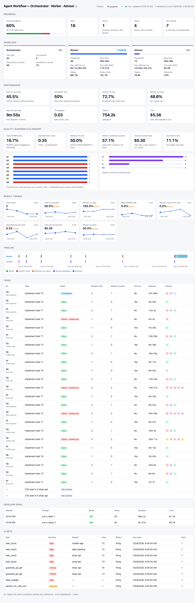
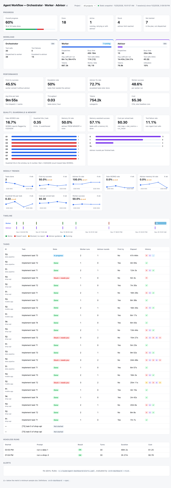

# Verification log

Machine: macOS (Darwin 27.2.0), Python 3.12.13. Date: 2026-11-25. All output below was copied from the
commands as run. `DEMO` is a scratch data directory seeded with `tests/fixtures/recorded/` (418 hook
events and 67 OTel lines), and `SCRATCH` is a temporary directory. Commands run from
`headless-dashboard/claude-home/agent-dashboard` unless noted. `orch-dashboard` here means
`python3 -m agentdash.cli`. A fixed `--now` is used where results depend on the clock.

Not covered here: a live Claude Code session exporting real OTel data (see design.md §11), and real
webhook deliveries to Slack, Discord or LINE. The tests use a stub sender, and the timer run used the
file channel.

## 1. Tests, fixture, ingest, CLI, alert dry run

```text
$ python3 --version
Python 3.12.13

$ python3 -m unittest discover -s tests -v   (from headless-dashboard/)
test_dedup (test_agentdash.TestAlerts.test_dedup) ... ok
test_default_rules_and_payload (test_agentdash.TestAlerts.test_default_rules_and_payload) ... ok
test_example_rules_file_loads (test_agentdash.TestAlerts.test_example_rules_file_loads) ... ok
test_failed_delivery_is_retried (test_agentdash.TestAlerts.test_failed_delivery_is_retried) ... ok
test_no_events_fires_and_resolves (test_agentdash.TestAlerts.test_no_events_fires_and_resolves) ... ok
test_quiet_hours_hold_then_release (test_agentdash.TestAlerts.test_quiet_hours_hold_then_release) ... ok
test_quiet_hours_wrap_midnight (test_agentdash.TestAlerts.test_quiet_hours_wrap_midnight) ... ok
test_transport_formats (test_agentdash.TestAlerts.test_transport_formats) ... ok
test_content_opt_in (test_agentdash.TestHook.test_content_opt_in) ... ok
test_failure_marker (test_agentdash.TestHook.test_failure_marker) ... ok
test_garbage_and_unwritable_never_fail (test_agentdash.TestHook.test_garbage_and_unwritable_never_fail) ... ok
test_guardrail_mode (test_agentdash.TestHook.test_guardrail_mode) ... ok
test_noop_without_env (test_agentdash.TestHook.test_noop_without_env) ... ok
test_structured_and_content_free (test_agentdash.TestHook.test_structured_and_content_free) ... ok
test_bad_lines_are_skipped (test_agentdash.TestIngestion.test_bad_lines_are_skipped) ... ok
test_incremental_and_partial_line (test_agentdash.TestIngestion.test_incremental_and_partial_line) ... ok
test_migrations_idempotent (test_agentdash.TestIngestion.test_migrations_idempotent) ... ok
test_missing_files_are_fine (test_agentdash.TestIngestion.test_missing_files_are_fine) ... ok
test_rotation_drains_old_file (test_agentdash.TestIngestion.test_rotation_drains_old_file) ... ok
test_truncation_and_copytruncate_are_idempotent (test_agentdash.TestIngestion.test_truncation_and_copytruncate_are_idempotent) ... ok
test_cost_one_source_per_session (test_agentdash.TestMetricsOnFixture.test_cost_one_source_per_session) ... ok
test_fixture_shape (test_agentdash.TestMetricsOnFixture.test_fixture_shape) ... ok
test_guardrails_by_number (test_agentdash.TestMetricsOnFixture.test_guardrails_by_number) ... ok
test_min_sample_flag (test_agentdash.TestMetricsOnFixture.test_min_sample_flag) ... ok
test_otel_join_and_tokens (test_agentdash.TestMetricsOnFixture.test_otel_join_and_tokens) ... ok
test_project_filter (test_agentdash.TestMetricsOnFixture.test_project_filter) ... ok
test_ratio_metrics_match_independent_count (test_agentdash.TestMetricsOnFixture.test_ratio_metrics_match_independent_count) ... ok
test_rounds_distribution (test_agentdash.TestMetricsOnFixture.test_rounds_distribution) ... ok
test_spec_complete (test_agentdash.TestMetricsOnFixture.test_spec_complete) ... ok
test_task_states (test_agentdash.TestMetricsOnFixture.test_task_states) ... ok
test_weekly_trends_are_exact (test_agentdash.TestMetricsOnFixture.test_weekly_trends_are_exact) ... ok
test_window_counts_each_task_once (test_agentdash.TestMetricsOnFixture.test_window_counts_each_task_once) ... ok
test_receiver_roundtrip (test_agentdash.TestOtlpReceiver.test_receiver_roundtrip) ... ok
test_refuses_non_loopback (test_agentdash.TestOtlpReceiver.test_refuses_non_loopback) ... ok
test_api (test_agentdash.TestOutputs.test_api) ... ok
test_cli_json (test_agentdash.TestOutputs.test_cli_json) ... ok
test_cli_reports (test_agentdash.TestOutputs.test_cli_reports) ... ok
test_cli_since_filter (test_agentdash.TestOutputs.test_cli_since_filter) ... ok
test_cli_spec_and_tick (test_agentdash.TestOutputs.test_cli_spec_and_tick) ... ok
test_snapshot_self_contained (test_agentdash.TestOutputs.test_snapshot_self_contained) ... ok
test_no_report_or_prompt_text_stored_by_default (test_agentdash.TestPrivacy.test_no_report_or_prompt_text_stored_by_default) ... ok
test_opt_in_keeps_redacted_text (test_agentdash.TestPrivacy.test_opt_in_keeps_redacted_text) ... ok
test_otlp_scrub (test_agentdash.TestPrivacy.test_otlp_scrub) ... ok
test_redaction_rules (test_agentdash.TestPrivacy.test_redaction_rules) ... ok
test_rollup_then_delete (test_agentdash.TestRetention.test_rollup_then_delete) ... ok
test_v1_demo_log_gives_same_core_numbers_as_v1_server (test_agentdash.TestV1Compatibility.test_v1_demo_log_gives_same_core_numbers_as_v1_server) ... ok
test_subset (test_agentdash.TestYamlLite.test_subset) ... ok

----------------------------------------------------------------------
Ran 47 tests in 1.996s

OK

$ python3 tests/fixtures/make_fixture.py tests/fixtures/recorded
{"tasks": 23, "done": 18, "stuck": 4, "active": 1, "guardrail_total": 8, "cost_usd": 5.361499, "events": 418}

$ orch-dashboard --dir DEMO --ingest   (second run, nothing new)
{
  "events": {
    "lines": 0,
    "new": 0,
    "dup": 0,
    "bad": 0
  },
  "otel": {
    "lines": 0,
    "spans": 0,
    "logs": 0,
    "points": 0,
    "bad": 0
  },
  "join": {
    "trace": 0,
    "single_running": 0
  },
  "notes": []
}

$ orch-dashboard --dir DEMO --json --project shop-api --task T2 | (selected fields)
[
 {
  "key": "shop-api/T2",
  "session_id": "s-shop-1",
  "state": "done",
  "worker_runs": 2,
  "advisor_rounds": 1,
  "stuck_reason": null,
  "guardrails": [
   "G1"
  ]
 },
 {
  "key": "shop-api/T2",
  "session_id": "s-shop-2",
  "state": "stuck",
  "worker_runs": 3,
  "advisor_rounds": 2,
  "stuck_reason": "max_advisor_rounds",
  "guardrails": [
   "G5"
  ]
 },
 {
  "key": "shop-api/T2",
  "session_id": "s-shop-3",
  "state": "done",
  "worker_runs": 1,
  "advisor_rounds": 0,
  "stuck_reason": null,
  "guardrails": []
 }
]

$ orch-dashboard --dir DEMO --tick --dry-run --rules alerts.example.yaml  (summary)
quiet_hours: False evaluated: 1
Counter({'send': 1})
Counter({'log': 1, 'slack': 1, 'line': 1})
{
 "schema": "agentdash.alert/v1",
 "id": "1b8eb7bb8b8a",
 "dedup_key": "task_stuck:shop-api:s-shop-3:T3",
 "rule": "task_stuck",
 "kind": "task_stuck",
 "severity": "high",
 "status": "firing",
 "project": "shop-api",
 "task_id": "T3",
 "session_id": "s-shop-3",
 "summary": "Task T3 is STUCK in shop-api after 0 advisor round(s)",
 "details": {
  "reason": "run_ended_unresolved",
  "worker_runs": 1,
  "advisor_rounds": 0,
  "title": "[T3] Implement task T3",
  "guardrails": []
 },
 "first_seen": 1795392000.0,
 "last_seen": 1795392000.0,
 "occurrences": 1,
 "inspect": {
  "command": "orch-dashboard --json --project shop-api --task T3",
  "url": "http://127.0.0.1:8765/?project=shop-api"
 }
}
```

## 2. Real alert tick (file channel), dedup, OTLP receiver, hook fail-open, ingest cost

`rules-file-only.yaml` has the same rules as `alerts.example.yaml`, but writes only to the file
channel, with a $0.50 budget and an 80 % fix-rate threshold, so that each rule kind fires on the
fixture.

```text
$ orch-dashboard --dir DEMO --tick --rules rules-file-only.yaml --now 2026-11-23T20:00Z   (1st tick)
actions Counter({'send': 8}) deliveries [('log', True, 8)]
$ (2nd tick, 5 minutes later: dedup)
actions [] deliveries []
$ wc -l alerts.log; first summaries
       1
- ['Task T2 is STUCK in mobile-app after 2 advisor round(s)', 'Task T2 is STUCK in data-pipeline after 2 advisor round(s)', 'Task T2 is STUCK in shop-api after 2 advisor round(s)', 'Task T3 is STUCK in shop-api after 0 advisor round(s)', 'Guardrail G3 hit on T4 in shop-api', 'Guardrail G8 hit on T3 in shop-api', 'Cost today $0.60 is over the $0.50 budget', 'Advisor fix rate 73% over the last 11 escalations (threshold 80%)']

$ OTLP receiver smoke test (curl, http/json)
POST /v1/logs json      -> 200
POST /v1/traces protobuf -> 415
{"ok":true} <- GET /health
last otel.jsonl line contains "TOP SECRET": 0
listening sockets: 127.0.0.1:4399
$ orch-dashboard --dir DEMO --ingest  (picks up the one new OTel line)
{'lines': 1, 'spans': 0, 'logs': 1, 'points': 0, 'bad': 0}

$ hook fail-open checks
AGENT_WORKFLOW unset -> exit 0
garbage stdin        -> exit 0
unwritable log dir   -> exit 0
hook wall time over 20 runs: median 20 ms, max 23 ms (registered async: true)

$ ingest cost on a 100k-line log (incremental vs. full)
first ingest of 100,000 lines: 2.9 s; next ingest with 1 new line: 3 ms (read 1 line)
```

Eight alerts in one tick exceed `max_per_channel_per_run` (5), so they went out as one digest line. The
second tick sent nothing (dedup).

## 3. install.sh (temporary HOME with an existing user setting and Stop hook)

Run from `headless-dashboard/`.

```text
$ ./install.sh --dry-run | wc -l ; files created:
      20
settings.json
$ ./install.sh && ./install.sh   (twice)
Merged hook entries in HOME/.claude/settings.json
$ hook groups per event in settings.json (user Stop hook + ours, no duplicates)
model: opus {'Stop': 2, 'PreToolUse': 1, 'PostToolUse': 1, 'PostToolUseFailure': 1, 'SubagentStart': 1, 'SubagentStop': 1}
$ stat alerts.env
-rw------- HOME/.claude/agent-dashboard/alerts.env
$ HOME/.local/bin/orch-dashboard --json | jq .schema
agentdash.metrics/v1
$ ./install.sh --uninstall
Removed agents, hook script, commands, package and services.
Data kept in HOME/.claude/agent-dashboard (events.jsonl, otel.jsonl, dashboard.sqlite3, alerts.yaml). Delete it yourself if you want.
Removed hook entries in HOME/.claude/settings.json
settings after uninstall: {'model': 'opus', 'hooks': {'Stop': [{'hooks': [{'type': 'command', 'command': 'echo mine'}]}]}}
commands left in bin:        0
```

## 4. UI and static snapshot

Live UI, `orch-dashboard --dir DEMO --port 8799`, opened in a browser at 1280 px. The only console
error was a 404 for `/favicon.ico`.



Static snapshot: `orch-dashboard --dir DEMO --snapshot docs/snapshot-example.html` (98,657 bytes; it
contains no `<script src` and no `https://`). It was opened from a plain static file server
(`python3 -m http.server` on the `docs/` folder) after the dashboard server had been stopped, so no API
was reachable. It rendered fully from the inlined data.


